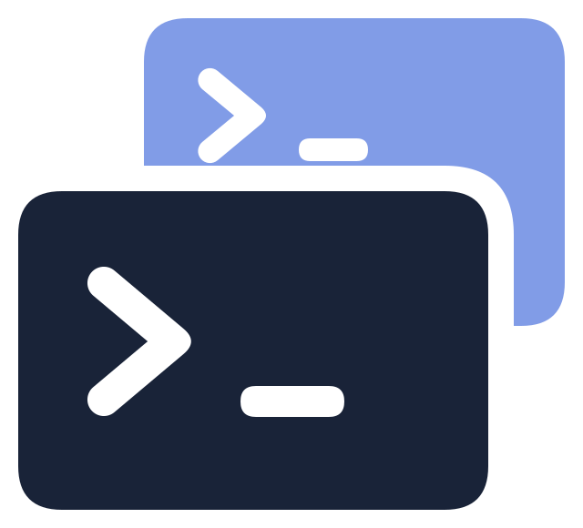
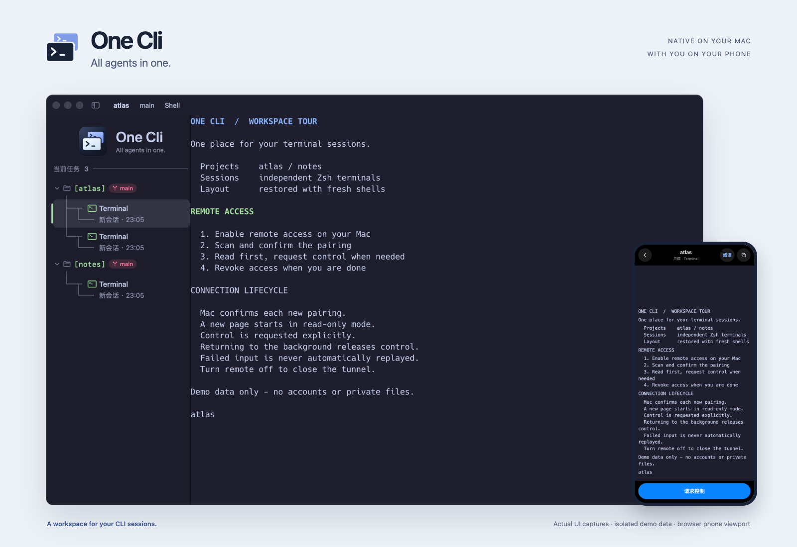
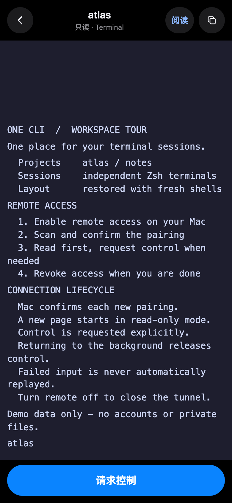
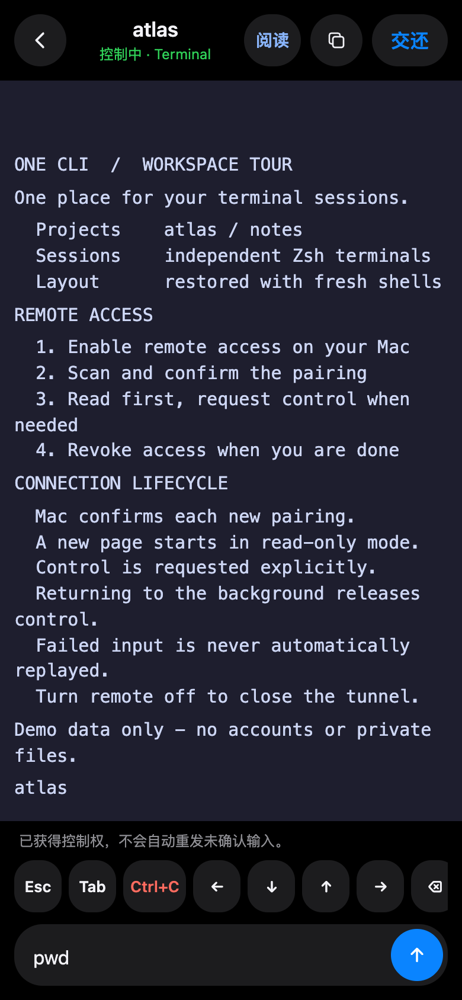

<div align="center">
  
  <h1>One Cli</h1>
  <p><strong>All agents in one.</strong></p>
  <p>多个 AI CLI，一个原生 macOS 终端工作台。</p>
  <p>macOS 14+ · Apple silicon · Swift · MIT</p>
  <p><a href="README.md">English</a> · <a href="#开始使用">开始使用</a> · <a href="#源码构建">源码构建</a> · <a href="PRIVACY.md">隐私与数据</a></p>
</div>

https://github.com/user-attachments/assets/0223f907-79fa-4a1f-a807-c2ec81143094

30 秒真实演示：Claude Code、Codex 与手机远程控制。[下载 1080p 视频](https://github.com/HaiBlueSea/one-cli/releases/download/v0.1.0/One-Cli-Launch-Live-1080p.mp4)。



<sub>应用界面为真实运行截图，使用演示数据；手机端截图来自实际远程后端与浏览器手机视口。</sub>

保留熟悉的工具，把终端集中起来。

One Cli 按工作目录组织多个终端，保留实际启动的命令名称，通过原生协议或观察 Hook 显示受支持的 Agent 状态。离开电脑时，可以用手机查看终端，按需申请控制。

## 为多会话工作而做

| 工作场景 | One Cli 提供的能力 |
| --- | --- |
| 在多个项目间切换 | 目录分组、Git 分支标识、可折叠侧栏。 |
| 同时运行多个 Agent | 独立 Zsh 终端、实际命令名、受支持的工作状态。 |
| 回到之前的工作区 | 保存目录、布局和外观；恢复时为每个终端创建新 Shell。 |
| 调整阅读体验 | 7 套主题、内置等宽字体、字号、行距和颜色设置。 |
| 暂时离开 Mac | 手机配对、只读查看、明确申请控制与撤销授权。 |

应用调用您自行安装、登录的 CLI，不提供这些工具的账号、订阅或 AI 模型。

## 开始使用

**系统要求：** Apple silicon Mac，macOS 14 及以上。请先安装并登录需要使用的 CLI。

1. 在本仓库的 **Releases** 中下载 `One-Cli-macos-arm64.zip` 和对应的 `.sha256` 文件。
2. 在两个文件所在目录打开终端，核对校验值：

   ```sh
   shasum -a 256 -c One-Cli-macos-arm64.sha256
   ```

3. 解压 ZIP，将 **One Cli.app** 拖入「应用程序」，然后打开。
4. 在终端中启动 CLI，操作与平时使用 Shell 相同。

当前包使用 **ad-hoc 签名，未做 Developer ID 签名或公证**，首次启动可能被 macOS 拦截。确认来源和校验值后，可按系统提供的入口在「系统设置 → 隐私与安全性」中对该应用选择「仍要打开」。不要全局关闭 Gatekeeper。详见 [Apple 官方说明](https://support.apple.com/zh-cn/102445)。

使用安装包不需要 Node.js。仓库尚未发布安装包时，可自行[源码构建](#源码构建)。

## 日常操作

从 [v0.1.1](https://github.com/HaiBlueSea/one-cli/releases/tag/v0.1.1) 起，可在「设置 → 界面语言」选择中文或 English，默认中文。桌面菜单、按钮、状态与提示立即切换并自动保存；远程页面随桌面语言刷新同步。命令名、目录和终端输出保留原文，快捷键动作与现有会话不变。版本变化见 [更新日志](CHANGELOG.md)。

| 快捷键 | 功能 |
| --- | --- |
| `⌘N` | 在当前目录新建终端。 |
| `⌘W` | 关闭当前终端并移除对应布局槽位。 |
| `⌘,` | 打开外观设置。 |
| `⌘+`／`⌘−`／`⌘0` | 增大、减小或恢复默认字号。 |
| `⌘` + 单击 | 使用系统默认应用打开链接。 |

关闭窗口或退出会保留布局。重新打开只创建新 Shell，**不重放命令、不恢复 Agent 任务、不重发远程输入**。带行号的文件链接目前只打开文件，不跳转到指定行。

### Agent 状态

| CLI | 接入方式 |
| --- | --- |
| Codex | 原生 daemon，支持独立的 `CODEX_HOME` 配置目录。 |
| Claude Code | 观察 Hook。 |
| Kimi Code | 观察 Hook。 |
| Cursor | 可作为终端运行；观察 Hook 不可用时，工作状态保持未知。 |

中文界面显示「运行中」「就绪」等状态，英文界面对应 `Running`、`Ready`；不支持、断连或未确认的状态保持未知。状态接入依赖已安装的 CLI 版本，不保证兼容所有版本。

对 **每套 Codex 配置**，在其 `config.toml` 已有的 `[tui]` 下合并以下配置，然后重新启动 Codex：

```toml
[tui]
terminal_title = ["session-id"]
```

不要重复创建 `[tui]`。通过 `PATH` 启动 Codex，包含函数内的 `command codex "$@"`，可以接入实际生效的配置目录；直接使用 CLI 绝对路径会绕过启动目录上报。观察 Hook 保留已有审批设置，请阅读 CLI 提示的信任要求。

## 用手机查看与控制

1. 从应用菜单打开「远程」面板，开启远程访问。
2. 手机扫描二维码，在 Mac 上确认配对。
3. 页面先只读；发送输入前申请控制。
4. 使用结束后撤销授权，或关闭远程访问。

<div align="center">
  
  
</div>

**先查看，需要时再控制。** 左图是只读页面，右图是申请控制后的输入界面。画面连接实际运行的应用，使用隔离演示数据，不含真实账号或生产会话；浏览器手机视口截图不等于真机兼容性认证。

| 远程流程 | 实际行为 |
| --- | --- |
| 建立连接 | 按需创建临时 HTTPS 地址，无需在路由器配置端口转发。 |
| 授权浏览器 | 手机扫码、Mac 确认，连接后默认只读。 |
| 发送输入 | 申请控制，使用文本或终端按键，结束后交还控制。 |
| 阅读长输出 | 换行阅读、表格局部横滚、原样布局与复制。 |
| 断线重连 | 不自动重发输入，发送失败或回执迟到时保留草稿。 |
| 结束访问 | 撤销授权或关闭远程；只关闭面板不会停止远程。 |

应用内置 `cloudflared`，用于建立临时 HTTPS 入口。流量经过 Cloudflare，**并非排除隧道服务商的端到端加密**。获得授权的设备可能看到终端中的敏感内容；获得控制后，可以使用该 Shell 的权限执行命令。

手机端支持阅读换行、表格局部横滚、原样视图和复制。刷新后回到只读，进入后台会交还控制，断线后不会自动重发输入。同一入口、同一浏览器的授权最长可保留 7 天，临时域名变化后需要重新配对。

## 源码构建

**构建要求：** Apple silicon、macOS 14+、Apple Command Line Tools 或 Xcode、**Swift 6.2+**。先用 `swift --version` 确认工具链，并使用支持目标 macOS 版本的工具链。SwiftTerm 与运行资源已随源码提供。

```sh
# 在仓库根目录构建独立的开发版。
sh scripts/build.sh
open "dist/One Cli Dev.app"

# 构建正式应用、ZIP 和 SHA-256 校验文件。
sh scripts/package.sh
```

| 产物 | 路径 |
| --- | --- |
| 开发版应用 | `dist/One Cli Dev.app` |
| 正式版应用 | `dist/One Cli.app` |
| ZIP 安装包 | `dist/One-Cli-macos-arm64.zip` |
| 校验文件 | `dist/One-Cli-macos-arm64.sha256` |

脚本不自动安装或启动应用。开发版使用 `com.aiterminal.dev` 和独立支持目录。由于内置 `cloudflared` 是 arm64，目前打包只支持 **Apple silicon**。

## 数据与能力边界

- 正式布局与外观：`~/Library/Application Support/AITerminal/`。
- 开发版数据：`~/Library/Application Support/AITerminalDev/`。
- CLI 登录、历史和会话由各 CLI 自行管理；运行接入可能追加观察 Hook、创建本地接入文件，详见[隐私与本地数据](PRIVACY.md)。
- 远程访问在主动开启前保持关闭；开启后，终端内容可以经 Cloudflare 离开 Mac。
- 真机手机输入、蜂窝网络、睡眠唤醒和长时压力验证有限；本仓库不宣称已经完成全面安全审计，也不保证所有 Mac 与 CLI 版本均兼容。

卸载时先退出，再移除应用。另行删除应用支持目录会清除保存的布局与偏好；CLI 自身数据需单独管理。

## 参与与许可

欢迎提交问题和聚焦的改进。上传日志或截图前，请阅读[贡献说明](CONTRIBUTING.md)和[安全说明](SECURITY.md)。

项目原创代码与图形使用 **[MIT 许可证](LICENSE)，© 2026 Oliver**，允许商用。第三方代码、字体、图标和工具沿用各自许可证，见[第三方声明](THIRD_PARTY_NOTICES.md)及[资源来源](Resources/ASSETS.md)。

One Cli 是独立项目。产品名称与图标仅用于识别兼容工具，不代表 OpenAI、Anthropic、Moonshot AI、Cursor 或 Cloudflare 的合作、赞助或背书。
